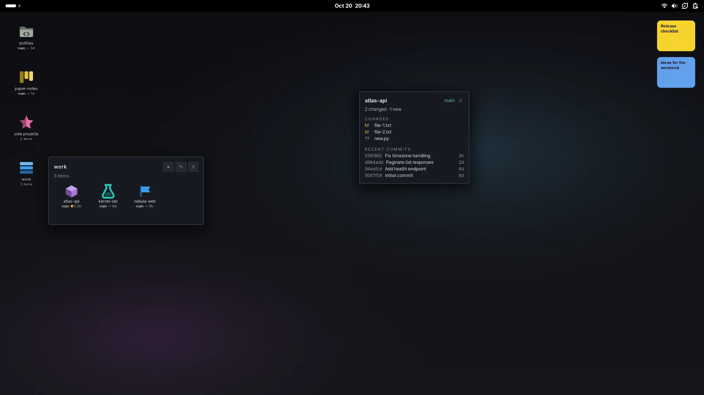
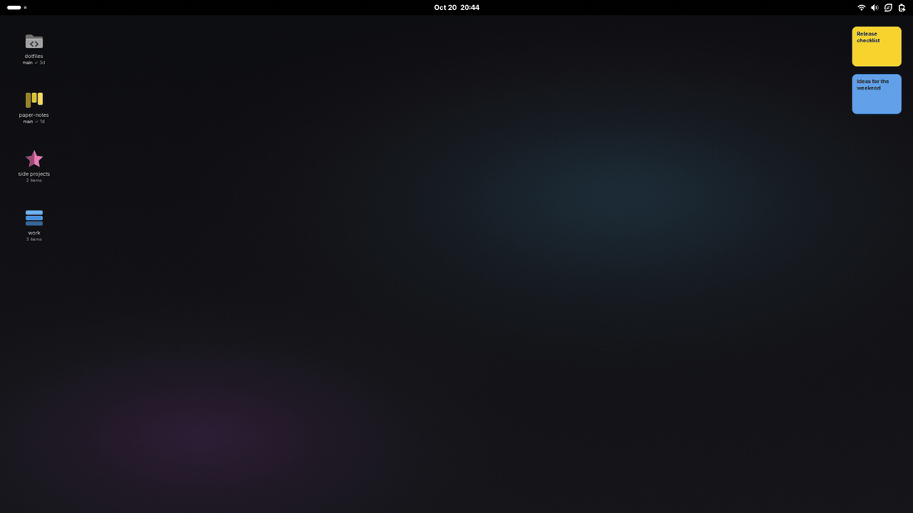
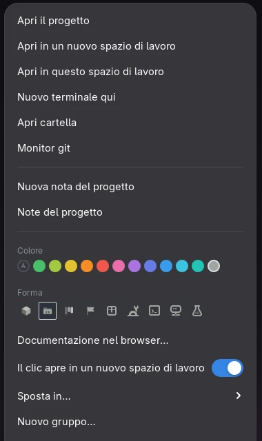
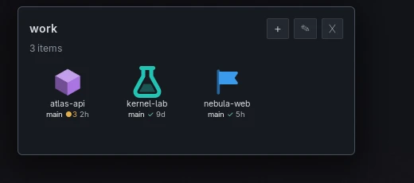
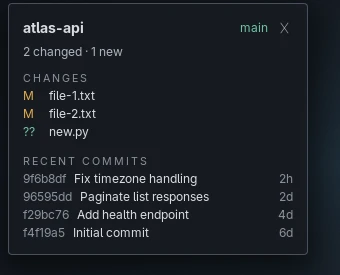
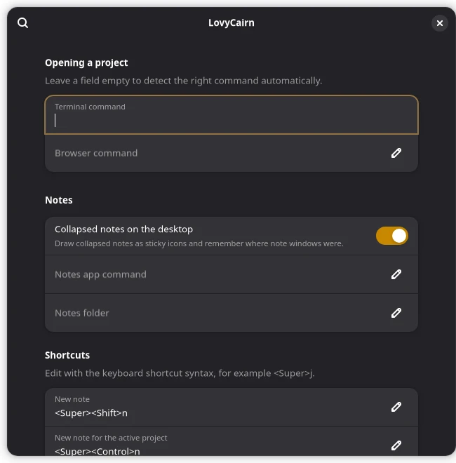
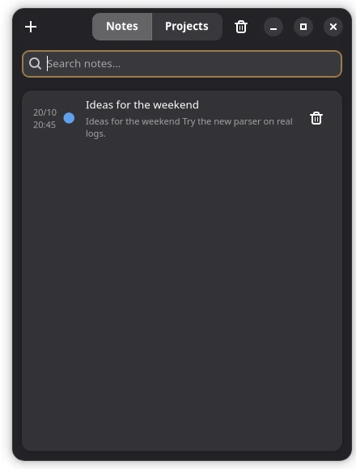
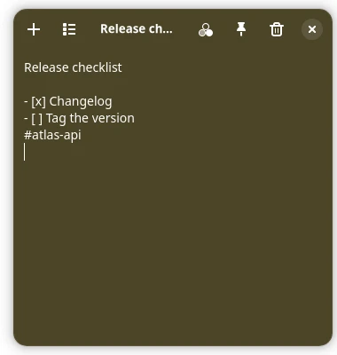
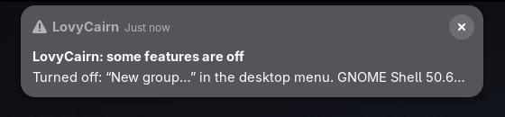

<div align="center">



<br>

[](LICENSE)
[](https://www.gnome.org)
[](https://github.com/bitfarmy/lovycairn/actions)
[](#traduzioni)
[](#installazione)

[English](README.md) · **Italiano**


</div>

**LovyCairn trasforma il desktop di GNOME in una bacheca di progetti.** Ogni progetto è un'icona che conosce il proprio stato git. Un clic apre il terminale nella cartella giusta — e, se vuoi, la documentazione nel browser — in uno spazio di lavoro nuovo. Già aperto? Un clic ti ci porta. Raggruppa i progetti, colorali, scrivi note che appartengono a loro.

Nessun demone, nessun database, nessun account. Un progetto è un file `.desktop` sul desktop, un gruppo è una cartella. Se togli LovyCairn, tutto resta tuo.

<div align="center">

</div>

<br>

<div align="center">

<br><sub>Apri un gruppo, dai un'occhiata a git, cambia aspetto a un progetto, salta con il selettore rapido.</sub>
</div>


## Cosa ottieni

<table>
<tr>
<td width="50%" valign="top">

### Un clic, pronto a lavorare
Terminale nella cartella del progetto e le pagine di documentazione che hai scelto, in uno **spazio di lavoro nuovo e vuoto**. Se il progetto è già aperto, vai direttamente alle sue finestre. Preferisci lo spazio attuale? Ogni progetto ha il suo interruttore e il menu offre entrambe le strade.

</td>
<td width="50%" valign="top">

### Git a colpo d'occhio
Ramo, <b>●3</b> modifiche non salvate oppure <b>✓</b> pulito, commit in avanti, età dell'ultimo commit — proprio sotto ogni icona. Una scheda **monitor git** mostra i file modificati e gli ultimi commit e si aggiorna da sola.

</td>
</tr>
<tr>
<td valign="top">

### Gruppi che sono semplici cartelle
Trascina un progetto su un gruppo, annida i gruppi, dai a ciascuno un colore e una forma. Aprine uno e i suoi progetti compaiono in un pannello. I gruppi vivono nella cartella Scrivania, quindi li vede anche File.

</td>
<td valign="top">

### Note che appartengono ai progetti
Una piccola app di note: un file Markdown per nota, tag come `#atlas-api`, archivio con ricerca, cestino. Riduci una nota a un'**icona adesiva** sul desktop. `Super+Ctrl+N` apre una nota per il progetto su cui stai lavorando.

</td>
</tr>
<tr>
<td valign="top">

### Selettore rapido
`Super+J` apre una ricerca tra progetti, app e gruppi. Scrivi, frecce, Invio. Senza mouse.

</td>
<td valign="top">

### Fatto per sopravvivere agli aggiornamenti di GNOME
A ogni avvio controlla le parti di GNOME da cui dipende. Se una cambia, si spegne solo quella funzione, ricevi **una notifica che spiega come sistemare**, e `lovycairn-doctor` ti dice il resto. [Dettagli](#fatto-per-sopravvivere-agli-aggiornamenti-di-gnome).

</td>
</tr>
</table>

<div align="center">

| Menu del progetto | Un gruppo | Monitor git |
|:---:|:---:|:---:|
|  |  |  |

</div>


## Installazione

**Ti serve:** GNOME Shell 50 o 51 (Fedora 44 e 46, e simili), `git` e un terminale (Ptyxis, GNOME Console, GNOME Terminal, Konsole, kitty, Alacritty, foot, WezTerm e xterm vengono riconosciuti; per ogni altro puoi indicare il comando nelle preferenze). L'app delle note richiede anche `python3-gobject`, GTK 4 e libadwaita, presenti in un GNOME standard.

```bash
git clone https://github.com/bitfarmy/lovycairn.git
cd lovycairn
scripts/install.sh          # senza root, scrive solo nella tua cartella home
```

Esci e rientra (GNOME carica le nuove estensioni al login), poi:

```bash
lovycairn-doctor                         # controlla che sia tutto a posto
lovycairn-add ~/code/mio-progetto        # il tuo primo progetto
```

…oppure clic destro sul desktop → **Aggiungi progetto…** (si apre il selettore di cartelle di GNOME), oppure clic destro su una cartella in File → *Script* → **Add as LovyCairn project**.

<details>
<summary><b>Altri modi di installare</b></summary>

- **Da una release:** scarica `lovycairn@bitfarmy.github.io.shell-extension.zip` dalle [release](https://github.com/bitfarmy/lovycairn/releases), poi `gnome-extensions install --force <file>` ed esci/rientra. (Installa solo l'estensione; l'app delle note e gli strumenti a riga di comando arrivano con `scripts/install.sh`.)
- **Senza l'app delle note:** `scripts/install.sh --no-notes` — l'estensione nasconde semplicemente le voci delle note.
- **Senza il controllo aggiornamenti:** `scripts/install.sh --no-autostart`.
- **extensions.gnome.org:** in programma. Le release sono già confezionate come richiede il sito.
</details>

## Come si usa

| Tu fai | LovyCairn fa |
|---|---|
| **Clic** su un progetto | Lo apre (terminale + documentazione) in uno spazio vuoto — oppure ti porta lì se è già aperto |
| **Clic** su un gruppo | Apre il suo pannello; clic fuori, o ✕, per chiuderlo |
| **Trascini** un'icona su un gruppo | Sposta il lanciatore dentro quel gruppo |
| **Clic destro** su un progetto | Apri qui / in un nuovo spazio, nuovo terminale, apri cartella, monitor git, note del progetto, **colore**, **forma**, pagine di documentazione, sposta, rimuovi |
| **Clic destro** su un gruppo | Rinomina, sottogruppo, colore, forma, sposta, sciogli |
| **Clic destro** sul desktop | **Nuovo gruppo…**, **Aggiungi progetto…** |
| `Super`+`J` | Selettore rapido |
| `Super`+`Maiusc`+`N` | Nuova nota |
| `Super`+`Ctrl`+`N` | Nuova nota con il tag del progetto attivo |

Scorciatoie, comandi del terminale e del browser e cartella delle note si cambiano nelle preferenze dell'estensione (`gnome-extensions prefs lovycairn@bitfarmy.github.io`).

<div align="center">

</div>

<details>
<summary><b>Impostazioni del progetto modificabili a mano</b> (chiavi del file <code>.desktop</code> del progetto)</summary>

| Chiave | Significato |
|---|---|
| `X-LovyCairn-Path` | La cartella del progetto (è ciò che rende un lanciatore un progetto) |
| `X-LovyCairn-Tag` | Il tag delle note, ad es. `atlas-api` per `#atlas-api` |
| `X-LovyCairn-Color` | Colore `#rrggbb` dell'icona |
| `X-LovyCairn-Icon` | `cube`, `folder-code`, `board`, `flag`, oppure un'icona a linee: `package-x-generic`, `applications-engineering`, `utilities-terminal`, `network-server`, `applications-science` |
| `X-LovyCairn-Docs` | Pagine da aprire con il progetto, separate da `;` |
| `X-LovyCairn-NewWorkspace` | assente = il clic chiede dove aprire; `true` = sempre un nuovo spazio; `false` = sempre quello attuale |

Un gruppo è una cartella che contiene un file `.group` con righe facoltative `color=#rrggbb` e `icon=folder|folder-solid|stack|grid|star|folder-documents|user-bookmarks`.
</details>

## Note

<div align="center">

&nbsp;&nbsp;

</div>

- Un file `.md` per nota in `~/Notes` (si cambia nelle preferenze). File semplici: li copi, li sincronizzi, ci fai `grep`.
- Le liste funzionano come ti aspetti: `- [ ]` si spunta con un clic, Invio continua l'elenco.
- `#tag` ovunque nella nota; un tag che corrisponde a un progetto mette la nota sotto **Progetti**.
- Riduci una nota (il pulsante con la puntina) a un adesivo colorato sul desktop; clic per espanderla, clic destro per rimandarla in archivio.
- Le note chiuse restano nell'archivio con la ricerca; quelle eliminate stanno nel cestino finché non le ripristini.

## Fatto per sopravvivere agli aggiornamenti di GNOME

Le estensioni di GNOME Shell usano parti della shell che non sono una promessa pubblica, quindi una nuova versione di GNOME può cambiarle. LovyCairn è fatto per rompersi *poco e a voce alta*:

1. **Autocontrollo a ogni avvio.** Verifica le sei parti interne da cui dipende. Se una manca, si spegne solo la funzione che la usa; tutto il resto continua a funzionare.
2. **Una notifica, con la soluzione.** Una volta per ogni versione di GNOME ti dice cosa è spento e cosa fare — aggiornare, o aprire una segnalazione — con i pulsanti per la pagina delle release e per copiare i dettagli.
3. **`lovycairn-doctor`.** Controlla l'estensione, la versione di GNOME per cui è marcata, git, il terminale e l'app delle note, e stampa esattamente come sistemare ciò che non va. `lovycairn-doctor --report` aggiunge il log della shell, pronto da incollare in una segnalazione.
4. **Un controllo silenzioso.** Una voce di avvio automatico esegue `lovycairn-doctor --watch`: al primo accesso dopo che GNOME è passato a una versione per cui LovyCairn non è marcato, ricevi una notifica. Nient'altro, mai.
5. **Provato in anticipo.** Il test senza interfaccia in `tests/` avvia una vera GNOME Shell in una sandbox; la CI lo esegue su Fedora e un lavoro settimanale lo esegue su **Fedora Rawhide** — il GNOME che sta arrivando — aprendo una segnalazione se si rompe, così le correzioni possono essere pronte prima che tu aggiorni.

<div align="center">

</div>

Quello che non può fare: ripararsi da solo. Una vera correzione è una nuova release; la notifica serve a dirtelo presto, e nulla viene scaricato o modificato alle tue spalle.

## Traduzioni

L'interfaccia è disponibile in **English** e **Italiano** (segue la lingua del sistema). Per aggiungere una lingua, copia `po/lovycairn.pot` in `po/<lingua>.po` (e `notes/po/lovycairn-notes.pot` per l'app delle note), traduci e apri una pull request. Vedi [CONTRIBUTING](CONTRIBUTING.md).

## Disinstallazione

```bash
scripts/uninstall.sh            # con --purge dimentica anche le posizioni delle icone
```

I tuoi progetti, le tue note e i lanciatori sul desktop non vengono mai toccati.

## Domande frequenti

<details>
<summary><b>Dopo l'installazione le icone non compaiono.</b></summary>

GNOME carica le nuove estensioni solo al login. Esci e rientra, poi esegui `lovycairn-doctor`.
</details>

<details>
<summary><b>Vedo due copie delle icone del desktop.</b></summary>

Un'altra estensione (o quella delle icone del desktop) disegna icone a sua volta. LovyCairn disegna le proprie dai lanciatori nella cartella Scrivania; spegni l'altra.
</details>

<details>
<summary><b>Funziona con il mio terminale / browser?</b></summary>

I terminali più comuni vengono riconosciuti. Per qualsiasi altro imposta **Comando del terminale** nelle preferenze, con `{dir}` dove va la cartella. I browser della famiglia Firefox e Chromium aprono la documentazione in una finestra nuova; con qualsiasi altro le pagine si aprono con il gestore predefinito.
</details>

<details>
<summary><b>Dove sono i miei dati?</b></summary>

Progetti: file `.desktop` nella cartella Scrivania. Gruppi: cartelle lì dentro. Posizioni delle icone: `~/.config/lovycairn/positions.json`. Note: `~/Notes`. Niente lascia la tua macchina; LovyCairn non fa alcuna connessione di rete.
</details>

<details>
<summary><b>Ha smesso di funzionare dopo un aggiornamento di GNOME.</b></summary>

È proprio per questo che esiste l'[autocontrollo](#fatto-per-sopravvivere-agli-aggiornamenti-di-gnome): esegui `lovycairn-doctor`, aggiorna all'ultima [release](https://github.com/bitfarmy/lovycairn/releases) e, se è già l'ultima, [apri una segnalazione](https://github.com/bitfarmy/lovycairn/issues/new/choose) con l'output di `lovycairn-doctor --report`.
</details>

## Contribuire

Segnalazioni, traduzioni e pull request sono benvenute — vedi [CONTRIBUTING](CONTRIBUTING.md). [docs/ARCHITECTURE.md](docs/ARCHITECTURE.md) spiega come si incastrano i pezzi.

## Licenza

[GPL-3.0-or-later](LICENSE). Libero da usare, studiare, modificare e condividere — anche al lavoro. Le versioni modificate che distribuisci devono restare libere con la stessa licenza.

<div align="center">

<sub>Fatto con cura per chi tiene troppi progetti aperti. Un piccolo cairn segna la strada. 🪨</sub>
</div>
