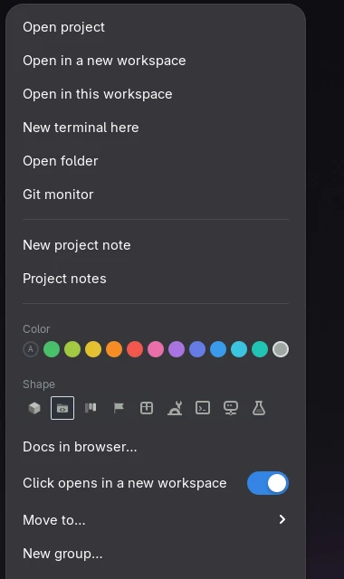

<div align="center">


<br>

[](LICENSE)
[](https://www.gnome.org)
[](https://github.com/bitfarmy/lovycairn/actions)
[](#translations)
[](#install)

**English** · [Italiano](README.it.md)


</div>

**LovyCairn turns your GNOME desktop into a project board.** Every project is an icon that knows its own git status. One click opens the terminal in the right folder — and the docs in your browser, if you want — in a fresh workspace. Already open? One click takes you there. Group projects, color them, jot notes that belong to them.

No daemon, no database, no account. A project is a `.desktop` file on your desktop, a group is a folder. Remove LovyCairn and everything is still yours.

<div align="center">

</div>

<br>

<div align="center">

<br><sub>Open a group, peek at git, restyle a project, jump with the quick picker.</sub>
</div>


## What you get

<table>
<tr>
<td width="50%" valign="top">

### One click, ready to work
Terminal in the project folder and the documentation pages you chose, in a **new empty workspace**. If the project is already open, you are taken to its windows instead. Prefer the current workspace? Every project has its own switch, and the menu offers both.

</td>
<td width="50%" valign="top">

### Git at a glance
Branch, <b>●3</b> uncommitted changes or <b>✓</b> clean, commits ahead, age of the last commit — right under each icon. A **git monitor** card shows changed files and recent commits and refreshes by itself.

</td>
</tr>
<tr>
<td valign="top">

### Groups that are just folders
Drag a project onto a group, nest groups, give each a color and a shape. Open one and its projects appear in a panel. Groups live in your Desktop folder, so Files shows them too.

</td>
<td valign="top">

### Notes that belong to projects
A small notes app: one Markdown file per note, tags like `#atlas-api`, an archive with search, a trash. Collapse a note into a **sticky icon** on the desktop. `Super+Ctrl+N` starts a note for the project you are working on.

</td>
</tr>
<tr>
<td valign="top">

### Quick picker
`Super+J` opens a search over projects, apps and groups. Type, arrow, Enter. No mouse.

</td>
<td valign="top">

### Built to survive GNOME updates
It checks the parts of GNOME it depends on at every start. If one changes, only that feature turns off, you get **one notification that says how to fix it**, and `lovycairn-doctor` tells you the rest. [Details](#built-to-survive-gnome-updates).

</td>
</tr>
</table>

<div align="center">

| Project menu | A group | Git monitor |
|:---:|:---:|:---:|
|  |  |  |

</div>


## Install

**You need:** GNOME Shell 50 or 51 (Fedora 44 and 46, and friends), `git`, and a terminal (Ptyxis, GNOME Console, GNOME Terminal, Konsole, kitty, Alacritty, foot, WezTerm or xterm are detected; any other can be set in the preferences). The notes app also needs `python3-gobject`, GTK 4 and libadwaita — all present on a stock GNOME.

```bash
git clone https://github.com/bitfarmy/lovycairn.git
cd lovycairn
scripts/install.sh          # no root, writes only inside your home folder
```

Log out and back in (GNOME loads new extensions at login), then:

```bash
lovycairn-doctor                         # checks that everything is in place
lovycairn-add ~/code/my-project          # your first project
```

…or right-click the desktop → **Add project…** (opens the GNOME folder chooser), or right-click a folder in Files → *Scripts* → **Add as LovyCairn project**.

<details>
<summary><b>Other ways to install</b></summary>

- **From a release:** download `lovycairn@bitfarmy.github.io.shell-extension.zip` from the [releases](https://github.com/bitfarmy/lovycairn/releases), then `gnome-extensions install --force <file>` and log out/in. (This installs the extension only; the notes app and the command-line tools come with `scripts/install.sh`.)
- **Without the notes app:** `scripts/install.sh --no-notes` — the extension then simply hides the note entries.
- **Without the update watcher:** `scripts/install.sh --no-autostart`.
- **extensions.gnome.org:** planned. Releases are packaged the way the site expects.
</details>

## Using it

| You do | LovyCairn does |
|---|---|
| **Click** a project | Opens it (terminal + docs) in an empty workspace — or takes you to it if it is already open |
| **Click** a group | Opens its panel; click outside, or ✕, to close |
| **Drag** an icon onto a group | Moves the launcher into that group |
| **Right-click** a project | Open here / in a new workspace, **what a click does** (ask, new workspace or this one), new terminal, open folder, git monitor, project notes, **color**, **shape**, docs pages, move, remove |
| **Right-click** a group | Rename, subgroup, color, shape, move, ungroup |
| **Right-click** the desktop | **New group…**, **Add project…** |
| `Super`+`J` | Quick picker |
| `Super`+`Shift`+`N` | New note |
| `Super`+`Ctrl`+`N` | New note tagged with the active project |

Shortcuts, the terminal and browser commands and the notes folder can all be changed in the extension preferences (`gnome-extensions prefs lovycairn@bitfarmy.github.io`).

<div align="center">

</div>

<details>
<summary><b>Project settings you can edit by hand</b> (keys of the project's <code>.desktop</code> file)</summary>

| Key | Meaning |
|---|---|
| `X-LovyCairn-Path` | The project folder (this is what makes a launcher a project) |
| `X-LovyCairn-Tag` | The note tag, e.g. `atlas-api` for `#atlas-api` |
| `X-LovyCairn-Color` | `#rrggbb` color of the icon |
| `X-LovyCairn-Icon` | `cube`, `folder-code`, `board`, `flag`, or an outline icon: `package-x-generic`, `applications-engineering`, `utilities-terminal`, `network-server`, `applications-science` |
| `X-LovyCairn-Docs` | Pages to open with the project, separated by `;` |
| `X-LovyCairn-NewWorkspace` | absent = a click asks where to open; `true` = always a new workspace; `false` = always the current one |

A group is a folder containing a file named `.group` with optional lines `color=#rrggbb` and `icon=folder|folder-solid|stack|grid|star|folder-documents|user-bookmarks`.
</details>

## Notes

<div align="center">

&nbsp;&nbsp;

</div>

- One `.md` file per note in `~/Notes` (change it in the preferences). Plain files: back them up, sync them, grep them.
- Checklists work as you expect: `- [ ]` toggles on click, Enter continues the list.
- `#tags` anywhere in a note; a tag that matches a project puts the note under **Projects**.
- Collapse a note (the pin button) into a colored sticky on the desktop; click it to expand, right-click to send it back to the archive.
- Closed notes live in the archive with search; deleted ones sit in the trash until you restore them.

## Built to survive GNOME updates

GNOME Shell extensions use parts of the shell that are not a public promise, so a new GNOME release can change them. LovyCairn is built to fail *small and loud*:

1. **Self-check at every start.** It probes the six internal parts it depends on. A missing one turns off only the feature that needs it; everything else keeps working.
2. **One notification, with the fix.** Once per GNOME version it tells you what is off and what to do — update, or open an issue — with buttons for the releases page and for copying the details.
3. **`lovycairn-doctor`.** Checks the extension, the GNOME version it is marked for, git, your terminal and the notes app, and prints exactly how to fix what is wrong. `lovycairn-doctor --report` adds the shell log, ready to paste in an issue.
4. **A silent watcher.** An autostart entry runs `lovycairn-doctor --watch`: the first login after GNOME moved to a version LovyCairn is not marked for, you get one notification. Nothing else, ever.
5. **Tested ahead of time.** The headless test in `tests/` runs a real GNOME Shell in a sandbox; the CI runs it on Fedora, and a weekly job runs it on **Fedora Rawhide** — the GNOME that is coming — and opens an issue if it breaks, so fixes can be ready before you upgrade.

<div align="center">

</div>

What it cannot do: repair itself. A real fix is a new release; the notification just tells you so early, and nothing is downloaded or changed behind your back.

## Translations

The interface is available in **English** and **Italiano** (it follows your system language). To add a language, copy `po/lovycairn.pot` to `po/<lang>.po` (and `notes/po/lovycairn-notes.pot` for the notes app), translate it, and open a pull request. See [CONTRIBUTING](CONTRIBUTING.md).

## Uninstall

```bash
scripts/uninstall.sh            # add --purge to also forget icon positions
```

Your projects, your notes and the launchers on your desktop are never touched.

## FAQ

<details>
<summary><b>The icons did not appear after installing.</b></summary>

GNOME only loads new extensions at login. Log out and in, then run `lovycairn-doctor`.
</details>

<details>
<summary><b>I see two copies of my desktop icons.</b></summary>

Another extension (or the desktop-icons extension) is drawing icons too. LovyCairn draws its own icons from the launchers in your Desktop folder; turn the other one off.
</details>

<details>
<summary><b>Does it work with my terminal / browser?</b></summary>

Common terminals are detected. For anything else set **Terminal command** in the preferences, with `{dir}` where the folder goes. Firefox-family and Chromium-family browsers open the docs in a new window; with any other browser the pages are opened through your default handler.
</details>

<details>
<summary><b>Where is my data?</b></summary>

Projects: `.desktop` files in your Desktop folder. Groups: folders there. Icon positions: `~/.config/lovycairn/positions.json`. Notes: `~/Notes`. Nothing leaves your machine; LovyCairn makes no network connection.
</details>

<details>
<summary><b>It stopped working after a GNOME update.</b></summary>

That is exactly what the [self-check](#built-to-survive-gnome-updates) is for: run `lovycairn-doctor`, update to the newest [release](https://github.com/bitfarmy/lovycairn/releases), and if it is already the newest, [open an issue](https://github.com/bitfarmy/lovycairn/issues/new/choose) with the output of `lovycairn-doctor --report`.
</details>

## Contributing

Bug reports, translations and pull requests are welcome — see [CONTRIBUTING](CONTRIBUTING.md). [docs/ARCHITECTURE.md](docs/ARCHITECTURE.md) explains how the pieces fit together.

## License

[GPL-3.0-or-later](LICENSE). Free to use, study, change and share — including at work. Modified versions that you distribute must stay free under the same license.

<div align="center">

<sub>Made with care for people who keep too many projects open. A small cairn marks the way. 🪨</sub>
</div>
